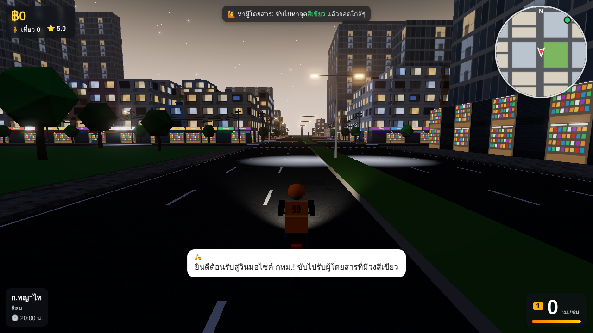

# วินมอไซค์ กทม. (Bangkok Win Rider)

เกมขับวินมอเตอร์ไซค์รับส่งผู้โดยสารในกรุงเทพฯ บนเว็บ แรงบันดาลใจจาก RayCity — ต้นแบบที่เล่นได้แล้ว




**วิธีเล่น:** ดับเบิลคลิก `Bangkok-Win.html` (ไฟล์เดียวจบ ไม่ต้องต่อเน็ต เปิดได้ทั้งคอมและมือถือ)

| ปุ่ม | ทำอะไร |
| --- | --- |
| W / ↑ | บิด |
| S / ↓ | เบรก / ถอย |
| Space | เบรกอย่างเดียว (ไม่ถอย) |
| A D / ← → | เลี้ยว |
| Shift | บิดสุด (เกจส้มด้านล่างขวา) |
| H | บีบแตร |
| C | เปลี่ยนมุมกล้อง (ตามหลัง / ไกล / มุมคนขับ) |
| R | กลับขึ้นถนน |
| G | เข้าอู่ที่ซุ้มวิน (ซื้อรถ / ซ่อม / แต่ง / ทำสี) |
| B | ท้าแข่ง Battle (ขับไปใกล้วินคู่แข่งที่มีป้าย ⚔️) |
| M | ปิด/เปิดเสียง |
| T | เลื่อนเวลา +1 ชั่วโมง |
| P | เปิด/ปิดมือถือ (หรือกดปุ่ม 📱 ซ้ายบน) — เกมหยุดระหว่างเปิด, Esc ปิด |

บนมือถือมีปุ่มบนจอให้

## มีอะไรแล้ว

- เมืองจำลองกรุงเทพฯ 1×1 กม. แบ่ง 9 ย่าน: จตุจักร, อนุสาวรีย์ชัยฯ, รัชดา, ข้าวสาร, สยาม, สุขุมวิท, เยาวราช, สีลม, คลองเตย
- ตึกแถวพร้อมป้ายร้านภาษาไทย กันสาด สายไฟพันกันบนเสาไฟ รถเข็นขายของ ซอยแยกพร้อมป้ายซอย
- รถไฟฟ้า BTS วิ่งบนรางลอยฟ้า 4 สถานี, วัดโพธิ์ / วัดพระราม 9 (โบสถ์ + เจดีย์ทอง), ตลาดนัดจตุจักร, ตลาดเยาวราช,
  สวนลุมพินี, อนุสาวรีย์ชัยฯ, ตึกสูงย่านสีลม/สยาม, แม่น้ำเจ้าพระยาฝั่งตะวันตก
- รถบนถนน**ขับชิดซ้าย**แบบไทย: รถเก๋ง, แท็กซี่สีชมพู/เขียวเหลือง, ตุ๊กตุ๊ก, รถเมล์, สองแถว, กระบะ, มอไซค์
- ระบบงานวิน: คนโบกเรียก → จอดรับ → นำทางด้วยเส้นเหลืองบนแผนที่ → ส่งถึงได้ค่าโดยสาร + ทิป + ดาว
  ผู้โดยสาร 4 แบบ (ทั่วไป / รีบมาก / นักท่องเที่ยว / แม่ค้า) พูดภาษาไทยตามสถานการณ์ ชน/ขึ้นฟุตบาท โดนบ่น หักทิป
- อู่วิน: เก็บเงินซื้อรถ 4 รุ่น (110cc → บิ๊กไบค์ 650cc) เซฟเงินไว้ในเบราว์เซอร์
- เสียงเครื่องยนต์/แตร/เงินเข้า สังเคราะห์ในเบราว์เซอร์ (ไม่มีไฟล์เสียง)

## แก้โค้ด

```bash
cd bangkok-win
npm install
npm run build      # สร้าง Bangkok-Win.html ใหม่จาก js/ + style.css
```

ระหว่างพัฒนาเปิด `index.html` ผ่าน web server ได้ (`python -m http.server 8000` ในโฟลเดอร์นี้ แล้วเปิด http://localhost:8000)

| ไฟล์ | หน้าที่ |
| --- | --- |
| `js/config.js` | ขนาดแผนที่ ชื่อย่าน/ถนน/สถานี รุ่นรถที่ขายในอู่ |
| `js/city.js` | สร้างเมือง: ตึก ถนน BTS วัด ตลาด ซุ้มวิน จุดรับส่ง |
| `js/traffic.js` | รถบนถนน (ขับซ้าย เลี้ยวที่แยก เบรกเมื่อมีรถข้างหน้า) |
| `js/jobs.js` | ผู้โดยสาร ค่าโดยสาร ทิป บทพูด |
| `js/bike.js` | ฟิสิกส์มอไซค์: เร่ง เบรก เลี้ยว การชน — **ค่าปรับความรู้สึกการขับทั้งหมดอยู่ใน `HANDLING` ด้านบนไฟล์** |
| `js/main.js` | กล้อง ลูปเกม ปุ่มลัด |
| `js/hud.js` | หน้าจอ แผนที่มุมขวา อู่ |
| `js/sky.js` | ท้องฟ้า เวลา แสงแดด/พระจันทร์ หมอก |
| `js/progress.js` | เลเวล XP ของที่ปลดล็อก |
| `js/phone.js` | มือถือในเกมและแอปทั้งหมด |
| `js/lights.js` | ไฟจราจร |
| `js/weather.js` | ฝน ถนนเปียก |
| `js/missions.js` | ภารกิจรายวัน |
| `js/customers.js` | ลูกค้ามีชื่อ หัวใจ ลูกค้าประจำ |
| `js/battle.js` | วินคู่แข่งและการแข่ง |
| `js/roadnet.js` | โครงข่ายถนน (กราฟ) การหาเส้นทาง |
| `js/cityosm.js` | สร้างเมืองจากแผนที่จริง |
| `tools/fetch-osm.mjs` / `tools/osm-import.mjs` | ดาวน์โหลด / แปลงข้อมูล OpenStreetMap |
| `js/garage.js` / `js/shop.js` | ชิ้นส่วน การสึก ของแต่ง / หน้าจออู่ |

## ระบบในเมือง

- **ไฟแดง** ทุกสี่แยก (สลับทิศเหนือ–ใต้ / ตะวันออก–ตะวันตก) รถยนต์จอดรอที่เส้น ฝ่าไฟแดง: ผู้โดยสารบ่น หักดาวและทิป ถ้าไม่มีผู้โดยสารอาจโดนตำรวจปรับ ฿200
- **ช่วงเร่งด่วน** 07:00–09:30 และ 17:00–19:30 รถเต็มถนน คนเรียกวินเยอะ ค่าโดยสาร ×1.3 · ดึก (00–05) รถโล่ง ค่าโดยสาร ×1.15
- **ฝนตก** มาเป็นช่วงๆ (ตั้งเป็นแดด/ฝนเองได้ในมือถือ) ถนนเปียกสะท้อนแสง ทัศนวิสัยแย่ รถลื่นขึ้น เบรกได้น้อยลง คนเรียกเยอะขึ้น ค่าโดยสาร ×1.2
- **ภารกิจรายวัน** 3 อย่างต่อวัน (เปลี่ยนตอนเที่ยงคืนในเกม) ทำเสร็จได้เงิน + XP ทันที
- **สมุดลูกค้า** ลูกค้ามีชื่อ 24 คน (ธรรมดา / หายาก Lv.3 / ตำนาน Lv.8) ส่งดีได้หัวใจ: ขาประจำ (+20% และโทรเรียกเรา) → เพื่อนสนิท (+40%) → VIP (+60%)
- **Battle** วินคู่แข่ง 5 คน (Lv.2–13) วิ่งอยู่ในเมือง กด B ใกล้ๆ เพื่อแข่งไปสถานที่สำคัญ: ใครตามหลังเกจลดตามระยะห่าง ชนแล้วเกจลด
  ถึงก่อนหรือเกจอีกฝ่ายหมด = ชนะ ได้เงิน + XP (ชนะครั้งแรก x2)

## อู่: ซ่อมและแต่งรถ (`js/garage.js`)

- รถมี 16 ชิ้นส่วนที่สึกตามระยะทางจริง: น้ำมันเครื่อง เครื่องยนต์ หัวเทียน กรองอากาศ แบตเตอรี่ ไฟหน้า โซ่-สเตอร์ คลัตช์ ยางหน้า/หลัง
  ผ้าเบรกหน้า/หลัง (สึกเร็วถ้าเบรกบ่อย) โช้คหลัง โช้คหน้า ชุดสี กระจก · ชนแล้วชิ้นส่วนเสียหาย
- ชิ้นส่วนต่ำกว่า ~70% เริ่มมีผล: เครื่องสึก = อืด, ยางหมด = ลื่น (ยิ่งตอนฝนตก), ผ้าเบรกหมด = เบรกไม่อยู่, ไฟหน้าแตก = มืด,
  น้ำมันเครื่องหมด = เครื่องสึกเร็ว 4 เท่าและวิ่งได้ช้าๆ
- ของแต่ง 9 หมวด: ท่อ, กล่อง ECU, กรอง/ลิ้นเร่ง, สเตอร์ (ทดจัด/ทดยาว), ยาง, ชุดเบรก, โช้ค, ล้อแม็ก, ลดน้ำหนัก (ปลดล็อกตามเลเวล)
  + ทำสีรถ สีล้อ ไฟนีออนใต้ท้อง · แท็บสเปคเทียบกับรถเดิม
- รถเดิมสภาพใหม่ไม่มีของแต่ง = ค่าการขับเดิมทุกอย่าง (`HANDLING` ใน `js/bike.js` ไม่ถูกแตะ)

## เลเวลและมือถือ

- ส่งผู้โดยสารได้ XP (มากขึ้นถ้าได้ดาวเยอะ ค่าโดยสารสูง หรือส่งที่สถานที่สำคัญ, ส่งช้าได้ครึ่งเดียว) เลเวลสูงสุด 50
- เลเวลอัปได้โบนัส ฿50 × เลเวลใหม่ และปลดล็อกของ: นักท่องเที่ยว (Lv.2), สกู๊ตเตอร์ (Lv.3), แม่ค้า (Lv.4), สปอร์ต 250cc (Lv.6),
  ค่าโดยสาร +10% (Lv.8), บิ๊กไบค์ (Lv.10), +10% อีก (Lv.12) และอาชีพที่จะมาทีหลัง: ช่าง (Lv.15), ไรเดอร์ส่งอาหาร (Lv.20)
- มือถือมีแอป: ภารกิจ, สมุดลูกค้า, Battle, โปรไฟล์, แผนที่ทั้งเมือง, ประวัติงาน, รถของฉัน, ปลดล็อก, ตั้งค่า (เสียง / คุณภาพภาพ / สภาพอากาศ / เลื่อนเวลา / เริ่มใหม่)
- เพิ่มของที่ปลดล็อก: แก้ `UNLOCKS` ใน `js/progress.js` · เพิ่มแอปมือถือ: เพิ่มใน `APPS` และเขียนฟังก์ชัน `app_ชื่อ` ใน `js/phone.js`

## ภาพและเวลา

- เวลาเดินจริง 1 ชั่วโมงในเกม = 1 นาที (เริ่ม 16:30 น. จะได้เห็นแดดเย็น → ฟ้าสีคราม → กลางคืน) นาฬิกาอยู่มุมซ้ายล่าง
- ท้องฟ้าคำนวณแสงผ่านชั้นบรรยากาศ ดวงอาทิตย์ขึ้นตะวันออกตกตะวันตกตามเวลา เงายาวตอนเช้า/เย็น หมอกควันสีตามท้องฟ้า
- กลางคืน: หน้าต่างติดไฟสุ่มทีละห้อง (บางห้องเปิดทีวี) ร้านเปิดไฟ ตึกออฟฟิศไฟติดบางชั้น ไฟถนนส้ม/ขาวส่องเป็นวงบนพื้น
  เสาไฟกลางเกาะถนนใหญ่ ไฟหน้า/ไฟท้ายรถทุกคัน ไฟหน้ามอไซค์ของเรา ไฟใน BTS ดาว พระจันทร์ แสงเมืองสะท้อนหมอก
- กระจกตึกสูงสะท้อนท้องฟ้า, ถนนยางมะตอยมีรอยปะ/คราบน้ำมัน, ทางเท้าปูกระเบื้อง, ฐานตึกมีเงาทึบ
- บนคอมมีแสงเรือง (bloom) รอบไฟ บนมือถือปิดไว้เพื่อให้ลื่น
- ค่าแสงทั้งหมดอยู่ใน `js/sky.js` ส่วนความสว่างไฟเมืองตอนกลางคืนอยู่ใน `setNight` ท้าย `js/city.js`

## การขับ

ใช้การขับแบบเวอร์ชันแรก (เลี้ยวไว ตอบสนองทันที เบรกแรง) ตัวเลขทั้งหมดอยู่ใน `HANDLING` ด้านบนของ `js/bike.js`
เช่น `brake` แรงเบรก, `lowSteer` / `steerFade` ความไวในการเลี้ยว, `lean` องศาเอียงที่เห็น, `radius` ขนาดตัวชน
ป้ายส้มข้างตัวเลขความเร็วบอกเกียร์ (R = ถอย)

## แผนที่ กทม. จริง (OpenStreetMap)

เกมรองรับถนนจริงแล้ว: ถนนโค้ง แยกหลายแฉก ถนนวันเวย์ ไฟแดงตามที่แมปไว้จริง ตึกตามรูปร่าง/ความสูงจริง สวน น้ำ
รางและสถานี BTS ร้านค้า/สถานที่ที่มีชื่อจริงเป็นจุดรับส่ง · รถยนต์ ไฟจราจร การนำทาง และวินคู่แข่งใช้โครงข่ายถนนเดียวกัน (`js/roadnet.js`)

ขั้นตอน (ต้องต่ออินเทอร์เน็ตไปที่ `overpass-api.de`):

```bash
cd bangkok-win
node tools/fetch-osm.mjs                       # ดาวน์โหลดย่านสยาม–สีลม → data/osm-siam-silom.json
node tools/osm-import.mjs data/osm-siam-silom.json data/city-siam-silom.json
npm run build                                  # ฝังแผนที่ลงใน Bangkok-Win.html
```

ย่านอื่น: `node tools/fetch-osm.mjs <ใต้> <ตะวันตก> <เหนือ> <ตะวันออก> <ชื่อ>` (ละติจูด/ลองจิจูด)
ถ้าเครื่องต่อ Overpass ไม่ได้ สคริปต์จะพิมพ์ query ให้ไปวางใน https://overpass-turbo.eu แล้ว Export เป็น raw OSM data
มาวางไว้ที่ `data/osm-<ชื่อ>.json` ได้

มีไฟล์ `data/city-*.json` อยู่ = เกมเปิดแผนที่จริง ไม่มี = เมืองจำลองแบบเดิม · สลับได้ในมือถือ → ตั้งค่า → แผนที่
ข้อมูลแผนที่ © OpenStreetMap contributors (ODbL) — เกมแสดงเครดิตนี้ในแผนที่มือถือ

## แผนต่อไป (ขยายเมือง)

1. **ขยายแผนที่จริง** — จากสยาม–สีลม ไปย่านอื่นจนทั้ง กทม.
2. **น้ำท่วมขัง** — ฝนหนักแล้วถนนบางสายน้ำท่วม
3. **งานแบบอื่น** — ส่งอาหาร, ส่งพัสดุ
4. **โมเดลรถจริง** — ใช้ `car-generator/` ในรีโปนี้สร้างรถ/มอไซค์ แล้วโหลด `.glb` เข้าเกม
5. **ออนไลน์หลายคน** — เห็นวินคนอื่นวิ่งในเมืองเดียวกัน

## ระบบที่เก็บไว้ทำทีหลัง

- **อาชีพ** — อยากให้มีทุกอาชีพในไทย วินมอไซค์เป็นอาชีพแรก อาชีพอื่นเพิ่มทีหลังทีละอาชีพ
  (เช่น ช่างซ่อมรถ, ไรเดอร์ส่งอาหาร, แม่ค้า, แท็กซี่, ตำรวจจราจร ฯลฯ)
- **อู่ช่าง: จูนรถเอง** — แผงปรับค่าการขับ (ความไวเลี้ยว แรงเบรก อัตราเร่ง องศาเอียง) ใช้ค่าจาก `HANDLING` ใน `js/bike.js`
  ไม่เปิดให้ใช้ตั้งแต่แรก ปลดล็อกเมื่อเลเวลถึง หรือเมื่อเป็นอาชีพช่าง
