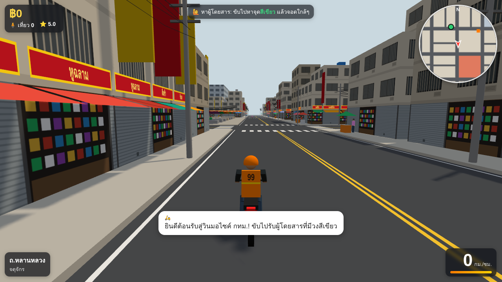

# วินมอไซค์ กทม. (Bangkok Win Rider)

เกมขับวินมอเตอร์ไซค์รับส่งผู้โดยสารในกรุงเทพฯ บนเว็บ แรงบันดาลใจจาก RayCity — ต้นแบบที่เล่นได้แล้ว



**วิธีเล่น:** ดับเบิลคลิก `Bangkok-Win.html` (ไฟล์เดียวจบ ไม่ต้องต่อเน็ต เปิดได้ทั้งคอมและมือถือ)

| ปุ่ม | ทำอะไร |
| --- | --- |
| W / ↑ | บิด |
| S / ↓ | เบรก / ถอย |
| Space | เบรกอย่างเดียว (ไม่ถอย) |
| A D / ← → | เลี้ยว |
| Shift | บิดสุด (เกจส้มด้านล่างขวา) |
| H | บีบแตร |
| C | เปลี่ยนมุมกล้อง (ตามหลัง / ไกล / มุมคนขับ) |
| R | กลับขึ้นถนน |
| G | เข้าอู่ที่ซุ้มวิน (ซื้อ/เปลี่ยนรถ) |
| M | ปิด/เปิดเสียง |

บนมือถือมีปุ่มบนจอให้

## มีอะไรแล้ว

- เมืองจำลองกรุงเทพฯ 1×1 กม. แบ่ง 9 ย่าน: จตุจักร, อนุสาวรีย์ชัยฯ, รัชดา, ข้าวสาร, สยาม, สุขุมวิท, เยาวราช, สีลม, คลองเตย
- ตึกแถวพร้อมป้ายร้านภาษาไทย กันสาด สายไฟพันกันบนเสาไฟ รถเข็นขายของ ซอยแยกพร้อมป้ายซอย
- รถไฟฟ้า BTS วิ่งบนรางลอยฟ้า 4 สถานี, วัดโพธิ์ / วัดพระราม 9 (โบสถ์ + เจดีย์ทอง), ตลาดนัดจตุจักร, ตลาดเยาวราช,
  สวนลุมพินี, อนุสาวรีย์ชัยฯ, ตึกสูงย่านสีลม/สยาม, แม่น้ำเจ้าพระยาฝั่งตะวันตก
- รถบนถนน**ขับชิดซ้าย**แบบไทย: รถเก๋ง, แท็กซี่สีชมพู/เขียวเหลือง, ตุ๊กตุ๊ก, รถเมล์, สองแถว, กระบะ, มอไซค์
- ระบบงานวิน: คนโบกเรียก → จอดรับ → นำทางด้วยเส้นเหลืองบนแผนที่ → ส่งถึงได้ค่าโดยสาร + ทิป + ดาว
  ผู้โดยสาร 4 แบบ (ทั่วไป / รีบมาก / นักท่องเที่ยว / แม่ค้า) พูดภาษาไทยตามสถานการณ์ ชน/ขึ้นฟุตบาท โดนบ่น หักทิป
- อู่วิน: เก็บเงินซื้อรถ 4 รุ่น (110cc → บิ๊กไบค์ 650cc) เซฟเงินไว้ในเบราว์เซอร์
- เสียงเครื่องยนต์/แตร/เงินเข้า สังเคราะห์ในเบราว์เซอร์ (ไม่มีไฟล์เสียง)

## แก้โค้ด

```bash
cd bangkok-win
npm install
npm run build      # สร้าง Bangkok-Win.html ใหม่จาก js/ + style.css
```

ระหว่างพัฒนาเปิด `index.html` ผ่าน web server ได้ (`python -m http.server 8000` ในโฟลเดอร์นี้ แล้วเปิด http://localhost:8000)

| ไฟล์ | หน้าที่ |
| --- | --- |
| `js/config.js` | ขนาดแผนที่ ชื่อย่าน/ถนน/สถานี รุ่นรถที่ขายในอู่ |
| `js/city.js` | สร้างเมือง: ตึก ถนน BTS วัด ตลาด ซุ้มวิน จุดรับส่ง |
| `js/traffic.js` | รถบนถนน (ขับซ้าย เลี้ยวที่แยก เบรกเมื่อมีรถข้างหน้า) |
| `js/jobs.js` | ผู้โดยสาร ค่าโดยสาร ทิป บทพูด |
| `js/bike.js` | ฟิสิกส์มอไซค์: เกียร์ เบรก การเอียงเลี้ยว ยางเกาะถนน การชน — **ค่าปรับความรู้สึกการขับทั้งหมดอยู่ใน `HANDLING` ด้านบนไฟล์** |
| `js/main.js` | กล้อง ลูปเกม ปุ่มลัด |
| `js/hud.js` | หน้าจอ แผนที่มุมขวา อู่ |

## การขับ

- เกียร์อัตโนมัติ 5 สปีด เสียงเครื่องขึ้นลงตามรอบและเกียร์ (ดูเกียร์ที่ป้ายส้มข้างตัวเลขความเร็ว, R = ถอย)
- ความเร็วต่ำเลี้ยวด้วยแฮนด์ (กลับรถในซอยได้), ความเร็วสูงเลี้ยวด้วยการเอียงรถ ยิ่งเร็วยิ่งต้องเอียงนาน วงเลี้ยวกว้างขึ้น
- เบรกแรงยางมีเสียงเอี๊ยด, ชนกำแพงแบบเฉียดรถจะไถลไปตามกำแพงแทนการหยุดกึก, ชนจังๆ รถส่าย
- ตัวรถชนเป็นทรงยาวแคบ แทรกระหว่างรถยนต์ที่จอดติดได้
- กล้องตามแบบสปริง เอียงตามรถ มุมภาพกว้างขึ้นตามความเร็ว

ค่าที่วัดได้ (รถ 110cc): 0–60 กม./ชม. 3.2 วิ, เบรกจาก 60 หยุดใน ~14 ม., วงเลี้ยวที่ 30 / 50 / 70 กม./ชม. ≈ 8 / 14 / 28 ม.

## แผนต่อไป (ขยายเมือง)

1. **แผนที่จริง** — ดึงถนนจาก OpenStreetMap มาสร้างเมือง แทนตารางสี่เหลี่ยม (เริ่มจากสยาม–สีลม แล้วขยายทั้ง กทม.)
2. **กลางวัน/กลางคืน + ฝนตก/น้ำท่วม** — ไฟนีออนตอนกลางคืน ผู้โดยสารเยอะช่วงเร่งด่วน
3. **รถติด + ไฟแดง** — ช่วงเช้า/เย็นรถติดหนัก วินได้เปรียบเพราะแทรกได้
4. **งานแบบอื่น** — ส่งอาหาร, ส่งพัสดุ, แข่งกับวินซุ้มอื่น, โหมดแข่งรถแบบ RayCity
5. **แต่งรถ** — ใช้ `car-generator/` ในรีโปนี้สร้างรถ/มอไซค์ แล้วโหลด `.glb` เข้าเกม
6. **ออนไลน์หลายคน** — เห็นวินคนอื่นวิ่งในเมืองเดียวกัน
